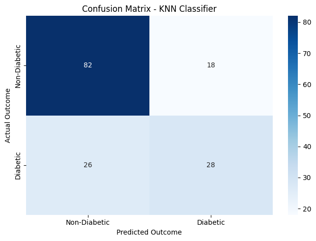
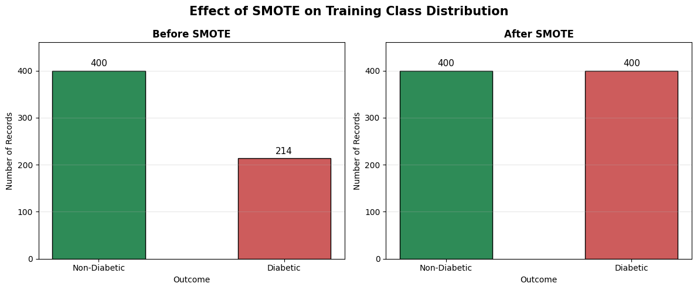
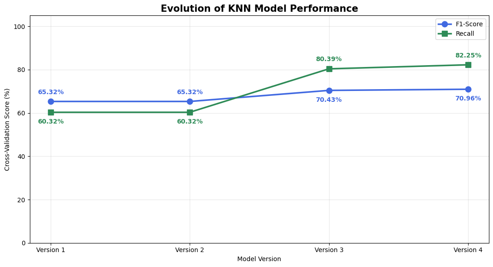
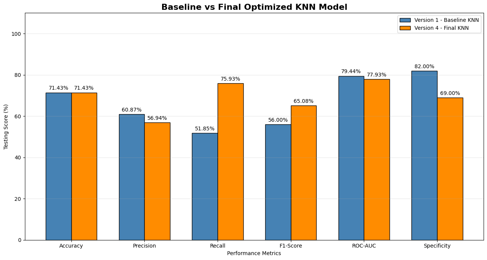
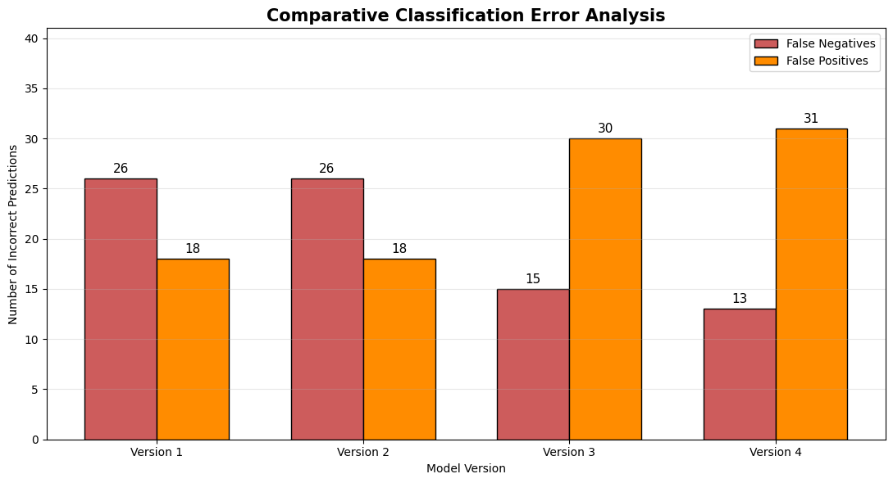

# Diabetes Prediction Using KNN

### A Comparative Study of Baseline and Optimized K-Nearest Neighbors Models

## Project Overview

This project implements a diabetes classification system using the K-Nearest Neighbors (KNN) machine learning algorithm.

The primary objective is to investigate the effectiveness of different optimization techniques in improving model recall and F1-score while maintaining baseline testing accuracy.

The project follows a systematic development approach, beginning with a baseline KNN model and progressing through hyperparameter optimization, SMOTE-based class balancing and advanced preprocessing optimization.

## Project Objectives

- Develop a baseline KNN classification model.
- Identify limitations of the initial model.
- Optimize model hyperparameters.
- Address class imbalance using SMOTE.
- Investigate advanced feature scaling and imputation techniques.
- Compare the performance of different model versions.
- Reduce false-negative classifications.
- Develop an interactive prediction demonstration.

## Dataset

The project uses the Pima Indians Diabetes Database.

**Source:** [Kaggle — Pima Indians Diabetes Database](https://www.kaggle.com/datasets/uciml/pima-indians-diabetes-database)

| Parameter | Value |
|---|---:|
| Total records | 768 |
| Input features | 8 |
| Target classes | 2 |
| Non-diabetic records | 500 |
| Diabetic records | 268 |
| Training records | 614 |
| Testing records | 154 |
| Train-test split | 80:20 |
| Random state | 42 |

## Technologies Used

- Python
- NumPy
- Pandas
- Matplotlib
- Seaborn
- Scikit-learn
- Imbalanced-learn
- Joblib
- Google Colab

## Project Methodology

1. Dataset loading and exploration
2. Missing-value treatment
3. Stratified train-test splitting
4. Feature scaling
5. Baseline KNN model development
6. Exploratory data analysis
7. Baseline performance evaluation
8. Hyperparameter optimization
9. SMOTE class balancing
10. Advanced preprocessing optimization
11. Comparative performance analysis
12. Final model selection
13. Interactive prediction system
14. System verification

## Model Development and Optimization

### Version 1 — Baseline KNN

- Median imputation
- StandardScaler
- K = 13
- Uniform neighbor weights
- Euclidean distance
- Accuracy-based hyperparameter selection

### Version 2 — Hyperparameter-Optimized KNN

- Expanded hyperparameter search
- Multiple distance metrics
- Uniform and distance-based weighting
- F1-score-based model selection

The optimization selected the same effective KNN configuration as the baseline model and did not produce a performance improvement.

### Version 3 — SMOTE Class-Balanced KNN

- Median imputation
- StandardScaler
- SMOTE class balancing
- K = 21
- Distance-based weighting
- Euclidean distance

SMOTE-based optimization improved recall and F1-score, although testing precision decreased.

### Version 4 — Advanced Preprocessing KNN

- MinMaxScaler
- KNNImputer
- SMOTE class balancing
- Expanded preprocessing and hyperparameter optimization
- K = 25
- Distance-based weighting
- Euclidean distance

Version 4 was selected using the highest mean cross-validation F1-score.

## Cross-Validation Performance

| Model | Accuracy | Precision | Recall | F1-Score | ROC-AUC |
|---|---:|---:|---:|---:|---:|
| Version 1 | 77.52% | 72.10% | 60.32% | 65.32% | 0.8282 |
| Version 2 | 77.52% | 72.10% | 60.32% | 65.32% | 0.8282 |
| Version 3 | 76.21% | 63.17% | 80.39% | 70.43% | 0.8359 |
| Version 4 | 76.37% | 62.74% | 82.25% | 70.96% | 0.8403 |

## Testing Performance

| Model | Accuracy | Precision | Recall | F1-Score | ROC-AUC |
|---|---:|---:|---:|---:|---:|
| Version 1 | 71.43% | 60.87% | 51.85% | 56.00% | 0.7944 |
| Version 2 | 71.43% | 60.87% | 51.85% | 56.00% | 0.7944 |
| Version 3 | 70.78% | 56.52% | 72.22% | 63.41% | 0.7994 |
| Version 4 | 71.43% | 56.94% | 75.93% | 65.08% | 0.7793 |

## Final Model Configuration

| Parameter | Selected Value |
|---|---|
| Selected model | Version 4 |
| Feature scaling | MinMaxScaler |
| Missing-value imputation | KNNImputer |
| Imputer neighbors | 3 |
| SMOTE sampling ratio | 1.0 |
| SMOTE neighbors | 5 |
| KNN neighbors | 25 |
| Neighbor weights | Distance |
| Distance metric | Euclidean |
| Model selection metric | F1-score |

## Major Project Achievements

- Maintained baseline testing accuracy of 71.43%.
- Improved testing recall from 51.85% to 75.93%.
- Improved testing F1-score from 56.00% to 65.08%.
- Achieved a relative recall improvement of 46.43%.
- Achieved a relative F1-score improvement of 16.21%.
- Reduced false negatives by 50%, from 26 to 13 records.

These improvements were accompanied by reduced precision, specificity and testing ROC-AUC, along with an increase in false positives from 18 to 31 records.

## Confusion Matrix Comparison

| Classification Result | Baseline Model | Final Model |
|---|---:|---:|
| True Negatives | 82 | 69 |
| False Positives | 18 | 31 |
| False Negatives | 26 | 13 |
| True Positives | 28 | 41 |

## Interactive Prediction System

The final optimized model was integrated into an interactive prediction demonstration with:

- Eight input features
- Input validation and error handling
- Automated feature scaling and missing-value imputation
- Predicted outcome classification
- Estimated class probabilities
- Prediction visualization
- Baseline and optimized model comparison

All seven predefined input validation tests and all nine individual prediction consistency checks passed successfully.

## Project Notebooks

- [Baseline KNN Implementation](notebooks/01_Diabetes_Prediction_KNN_Baseline.ipynb)
- [Complete KNN Optimization and Evaluation](notebooks/02_Diabetes_Prediction_KNN_Optimization.ipynb)

## Experimental Results

All exported experimental results are available in the [results directory](results/).

Dataset information and download instructions are available in the [dataset directory](dataset/).

## Project Visualizations

### 1. Baseline KNN Confusion Matrix

The baseline model produced 26 false-negative classifications, motivating further optimization.

### 2. Effect of SMOTE Class Balancing

The following graph demonstrates the effect of full SMOTE balancing on the training class distribution.

### 3. Model Improvement Journey

Cross-validation recall and F1-score improved through SMOTE-based optimization and advanced preprocessing.

### 4. Baseline vs Final Optimized Model

The final model maintained testing accuracy while improving recall and F1-score, with trade-offs in precision, specificity and ROC-AUC.

### 5. Classification Error Analysis

False negatives were reduced by 50%, from 26 to 13 records, while false positives increased from 18 to 31 records.

Additional graphs, including ROC curves, comparative confusion matrices and interactive prediction demonstrations, are available in the [visualizations directory](visualizations/).

## How to Run the Project

1. Download the required dataset from Kaggle.
2. Prepare the headerless CSV file as described in the dataset documentation.
3. Download the desired notebook from the notebooks directory.
4. Open Google Colab at https://colab.research.google.com/.
5. Upload the downloaded notebook.
6. Install any required missing Python packages.
7. Run the notebook cells sequentially.
8. Upload the dataset when prompted.
9. Enter synthetic sample values when prompted by the interactive prediction cells.

The complete optimization notebook contains extensive grid searches and may require considerable execution time.

## Limitations

- Relatively small dataset representing a specific study population.
- Increased false-positive classifications after optimization.
- Potential overfitting indicated by training and testing performance differences.
- Cross-validation results are affected by model selection.
- No independent external dataset validation.
- Estimated class probabilities are not calibrated clinical risk estimates.
- Synthetic prediction examples demonstrate functionality rather than clinical accuracy.

## Future Scope

- Evaluation using larger and more diverse datasets.
- Nested cross-validation and independent external validation.
- Probability calibration.
- Investigation of alternative classification algorithms.
- Further investigation of feature selection and class-balancing methods.

## Conclusion

The project demonstrates how systematic optimization of a KNN classifier can improve recall and F1-score while maintaining baseline testing accuracy.

The final optimized model reduced false-negative classifications by 50%, although this improvement involved trade-offs in other evaluation metrics.

The developed interactive prediction system demonstrates the practical integration of a fitted machine learning pipeline with input validation, preprocessing, classification and visualization.

## Disclaimer

This project is intended solely for educational and academic machine learning experimentation. It is not a clinically validated medical diagnostic system and must not be used for medical decision-making.

## Acknowledgement

The Pima Indians Diabetes Database and the open-source Python machine learning libraries used in this project are gratefully acknowledged.
